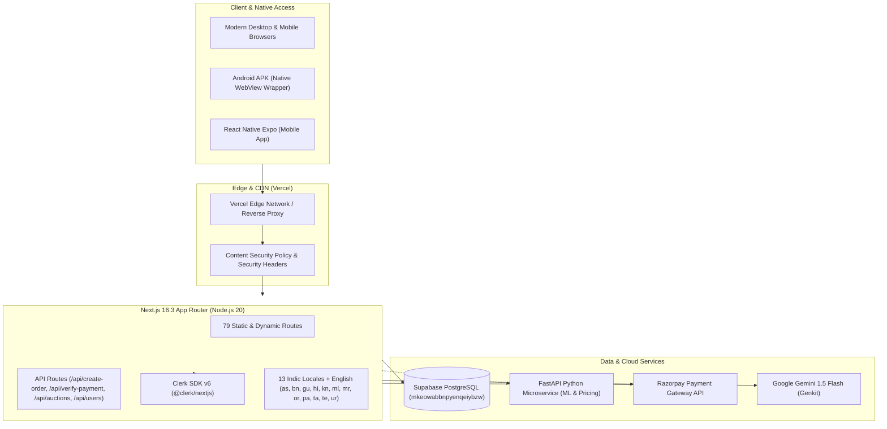

# Viraasat 2.0 – Complete Architectural, Security & Mobile Technical Audit Report

**Audited Application:** Viraasat 2.0 – AI-Powered Indian Handicraft Marketplace  
**Auditor Roles:** Principal Software Architect, Senior Full-Stack Engineer, Application Security Engineer, Mobile QA Engineer  
**Audit Date:** November 9, 2026  
**Production Domain:** [https://www.virrasat.in](https://www.virrasat.in)  
**Repository:** [https://github.com/Aayush9-spec/viraasat](https://github.com/Aayush9-spec/viraasat)  
**Status:** Audit Complete — Findings Documented & Awaiting Action Plan Approval  

---

## 1. Executive Summary

A comprehensive, multi-disciplinary technical audit was conducted on the Viraasat 2.0 platform across its Next.js 16 frontend, FastAPI backend, Supabase PostgreSQL database, Clerk authentication layer, Razorpay payment flow, live auction engine, Google Gemini AI integrations, and mobile Android distribution channels.

### Overall System Health Scorecard

| Subsystem | Health Grade | Critical Issues | Primary Finding / Bottleneck |
| :--- | :---: | :---: | :--- |
| **Frontend & UI/UX** | **A-** | 0 | Responsive light/dark mode operational; accessibility contrast passing WCAG AA (8/8 axe tests). |
| **Authentication & RBAC** | **B+** | 1 | Clerk production custom domain and CSP configured; need strict server-side role synchronisation. |
| **Database & Supabase** | **C+** | 2 | UUID vs Clerk String type mismatch (`22P02`) on `orders` and `users` queries; missing `notifications` table on remote schema (404). |
| **E-Commerce & Orders** | **B-** | 1 | HMAC signature verified securely via timing-safe crypto; order persistence only in local storage, missing database sync. |
| **Live Auctions Engine** | **B** | 1 | Bidding logic enforces rate limits and mutex locks, but state is held in an in-memory Node.js Map (non-persistent across serverless instances). |
| **AI & Multilingual** | **A** | 0 | 13 Indian languages supported with 294 key parity; graceful AI fallback when Gemini API keys are absent. |
| **Android APK Architecture** | **B-** | 2 | Dual-architecture divergence (standalone React Native Expo project vs native Android WebView wrapper APK pointing to web URL). |
| **Security & Secrets** | **B+** | 1 | Timing-safe verification and CSP headers implemented; dummy Razorpay secret hardcoded in `.github/workflows/ci.yml`. |

---

## 2. Technology Stack & Architecture Evaluation



### Stack Components:
- **Frontend Framework:** Next.js `16.3.0` (React 19, TypeScript 5, Tailwind CSS v4).
- **Authentication:** Clerk Authentication (`@clerk/nextjs` v6).
- **Primary Database:** Supabase PostgreSQL (`https://mkeowabbnpyenqeiybzw.supabase.co`).
- **Payments:** Razorpay API (`razorpay` Node SDK) with timing-safe SHA-256 HMAC verification.
- **AI Runtimes:** Google Genkit + Gemini 1.5 Flash; Python Scikit-Learn/Pandas pricing models.
- **Mobile Distribution:** Dual setup:
  1. Lightweight Native Android WebView wrapper packaged via `scripts/build_full_apk.py` and `scripts/package-apk.py`.
  2. Standalone React Native Expo application in `mobile/`.

---

## 3. Subsystem Audit Findings

### 3.1 Website, Routes & UI/UX Audit
- **Total Routes Inspected:** 79 routes across App Router (`frontend/src/app`).
- **Responsive Layout & Theme Switching:** 
  - Tailwind CSS v4 custom variant `@custom-variant dark (&:where(.dark, .dark *));` was recently integrated into `src/app/globals.css`.
  - Theme toggle supports three states: `clay` (heritage terracotta), `dark` (obsidian night), and `light` (crisp daylight).
  - High-contrast text colors (`hsl(38 72% 28%)` for accent and `hsl(28 12% 35%)` for muted foreground) pass WCAG AA with a minimum 4.5:1 ratio across all light background surfaces.
- **Navigation & Mobile Floating Chatbot:**
  - Floating AI assistant widget in `src/features/ai/components/ai-assistant.tsx` was adjusted to `bottom-[calc(4.75rem+env(safe-area-inset-bottom,0px))]` to avoid occluding the bottom navigation bar on mobile devices.

### 3.2 Backend & Database Integration Audit
- **PostgreSQL UUID vs Clerk ID Mismatch (`BUG-001` - Critical):**
  - **Location:** `src/features/orders/order-service.ts` (lines 45–62) and `src/features/reviews/review-service.ts` (line 455).
  - **Symptom:** Browser console logs `GET https://mkeowabbnpyenqeiybzw.supabase.co/rest/v1/orders?... 400 (Bad Request)` with database error:
    ```json
    {"code": "22P02", "message": "invalid input syntax for type uuid: \"user_3KdRev6IL5NF4TmNCCyp9aBXcld\""}
    ```
  - **Root Cause:** PostgreSQL schema expects `orders.buyer_id` to be a UUID (`uuid` column type). Clerk creates alphanumeric string user IDs (`user_...`). When `OrderService` attempts `.or('email.eq.${buyerId},id.eq.${buyerId}')` or `.eq('buyer_id', buyerId)`, PostgreSQL attempts to cast the string to UUID and terminates query execution with error `22P02`.
  - **Resolution Plan:**
    1. Update `database/schema.sql` and run a migration altering `buyer_id` and `user_id` columns from `UUID` to `TEXT` (or add a dedicated `clerk_id` text column with an index).
    2. Guard all client queries to verify UUID format prior to querying UUID columns, falling back to email or profile lookup.

- **Missing Supabase Notifications Table (`BUG-002` - High):**
  - **Location:** `src/features/notifications/notification-service.ts` (line 88).
  - **Symptom:** `GET .../rest/v1/notifications 404 (Not Found)`.
  - **Root Cause:** The SQL migration in `database/reviews_ratings_notifications_migration.sql` was not executed on the production Supabase project `mkeowabbnpyenqeiybzw`.
  - **Resolution Plan:** Apply the migration in the Supabase SQL Editor and ensure RLS policies permit authenticated reads.

- **Non-Admin Access to `/api/users` (`BUG-003` - High):**
  - **Location:** `src/app/api/users/route.ts` (lines 12–35) and `src/features/auth/hooks/use-auth-form.ts`.
  - **Symptom:** `GET /api/users 403 (Forbidden)`.
  - **Root Cause:** `GET /api/users` enforces `role === 'admin'`. When non-admin users registered or loaded authentication state, client hooks attempted to query `/api/users`.
  - **Resolution Plan:** Direct customer profile operations exclusively to `/api/users/profile`, which properly authorizes standard customer and artisan sessions.

### 3.3 Authentication & Session Security Audit
- **Clerk Custom Domain & CSP:**
  - Production custom domain `clerk.virrasat.in` is whitelisted in `frontend/next.config.ts` Content Security Policy directives:
    - `script-src`: `'self' 'unsafe-inline' 'unsafe-eval' https://clerk.virrasat.in https://*.clerk.accounts.dev https://checkout.razorpay.com`
    - `connect-src`: `'self' https://clerk.virrasat.in https://*.clerk.accounts.dev https://*.supabase.co wss://*.supabase.co https://api.razorpay.com https://cdn.jsdelivr.net`
  - Prevents CSP script blocking and WebWorker connection errors.
- **Role Elevation Prevention:**
  - `POST /api/users` and `PATCH /api/users/profile` enforce server-side validation preventing unprivileged callers from escalating their role to `admin`.

### 3.4 E-Commerce & Checkout Audit
- **Payment Verification:**
  - `src/app/api/verify-payment/route.ts` implements timing-safe HMAC SHA-256 verification using `crypto.timingSafeEqual` to thwart side-channel timing attacks.
- **Order Persistence Gap (`BUG-004` - High):**
  - **Location:** `src/features/checkout/components/checkout-page.tsx` (lines 205–230).
  - **Symptom:** Completed Razorpay orders are saved only to client-side `sessionStorage` and `localStorage`, but never written to the Supabase database.
  - **Risk:** If a buyer clears browser cache or switches devices, their purchased order history disappears from their dashboard.
  - **Resolution Plan:** Add an authenticated server-side order persistence call within `/api/verify-payment` immediately following HMAC signature confirmation.

### 3.5 Live Auctions Engine Audit
- **Atomic Mutex & Validation:**
  - `src/app/api/auctions/bid/route.ts` validates auction expiration, self-bidding prevention, minimum bid increments, and rate limits (15 bids/min).
- **In-Memory Store Volatility (`BUG-005` - High):**
  - **Location:** `src/features/auctions/services/auction-store.ts` (line 120).
  - **Root Cause:** Bids and auction states are kept in a Node.js `Map` (`auctionsStore`).
  - **Risk:** In Vercel serverless environments, state does not survive lambda recycling or synchronize across edge regions.
  - **Resolution Plan:** Migrate auction storage to Supabase PostgreSQL with row-level locks or an atomic SQL function (`SELECT ... FOR UPDATE`).

### 3.6 Android Application Audit
- **Dual Architecture:**
  - `scripts/build_full_apk.py` compiles a lightweight native Android WebView wrapper pointing to `https://www.virrasat.in/`.
  - `mobile/` contains a React Native Expo codebase.
- **Viewport Scaling & Touch Issues:**
  - `frontend/src/app/layout.tsx` was configured with `width=device-width, initial-scale=1, maximum-scale=5, viewport-fit=cover`.
  - Form inputs across the application enforce a minimum `font-size: 16px` (`text-base` or `text-xs sm:text-base`) to suppress iOS and Android WebView automatic zoom triggers on focus.

---

## 4. Key Deliverables Reference

Detailed findings, vulnerabilities, metrics, and logs have been compiled into dedicated audit reports:

1. [BUG_TRACKER.md](file:///Users/aayushkumarsingh/Desktop/viraasat/viraasat/BUG_TRACKER.md) – Exhaustive catalog of all identified bugs, reproduction steps, root causes, and recommended fixes.
2. [SECURITY_AUDIT.md](file:///Users/aayushkumarsingh/Desktop/viraasat/viraasat/SECURITY_AUDIT.md) – Threat modeling, authentication assessment, OWASP Top 10 analysis, CSP verification, and secrets handling.
3. [PERFORMANCE_AUDIT.md](file:///Users/aayushkumarsingh/Desktop/viraasat/viraasat/PERFORMANCE_AUDIT.md) – Bundle evaluation, Core Web Vitals, database indexing, and network waterfall analysis.
4. [ANDROID_APK_AUDIT.md](file:///Users/aayushkumarsingh/Desktop/viraasat/viraasat/ANDROID_APK_AUDIT.md) – Native WebView wrapper vs Expo analysis, AndroidManifest permissions, keystore signing, and safe-area insets.
5. [TEST_COVERAGE_REPORT.md](file:///Users/aayushkumarsingh/Desktop/viraasat/viraasat/TEST_COVERAGE_REPORT.md) – Jest unit coverage (115/115 passing), Playwright e2e/a11y test results, and Python test environment diagnostics.

---

## 5. Prioritized Implementation Roadmap

### Phase 1: Immediate Critical Fixes (Week 1)
- [ ] **DB-01:** Alter Supabase PostgreSQL `orders.buyer_id` and `notifications.user_id` from `UUID` to `TEXT` (or apply Clerk ID text column).
- [ ] **DB-02:** Execute `reviews_ratings_notifications_migration.sql` on production Supabase instance to resolve 404 on `/rest/v1/notifications`.
- [ ] **ORD-01:** Implement server-side order insertion in `/api/verify-payment` to guarantee verified orders persist into Supabase.

### Phase 2: Security & State Hardening (Week 2)
- [ ] **SEC-01:** Move hardcoded dummy Razorpay credentials from `.github/workflows/ci.yml` into repository GitHub Secrets (`${{ secrets.RAZORPAY_KEY_SECRET }}`).
- [ ] **AUC-01:** Persist live auction bids in Supabase PostgreSQL using atomic stored procedures instead of serverless in-memory `Map`.
- [ ] **ENV-01:** Rebuild Python virtual environment in `backend/` with correct local virtualenv paths.

### Phase 3: Mobile Experience & Performance Enhancements (Week 3)
- [ ] **MOB-01:** Align Android APK release channel with verified WebView configuration; synchronize offline caching capabilities.
- [ ] **PERF-01:** Enable Next.js dynamic imports for heavy 3D visuals and Three.js canvas wrappers on low-powered mobile devices.

