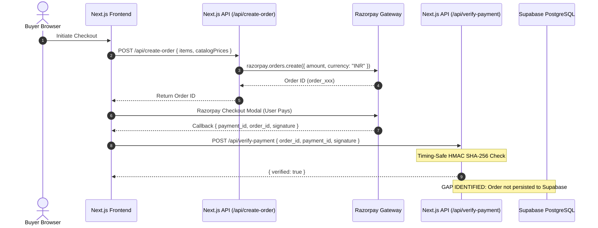

# Viraasat 2.0 – Application Security Audit & Threat Assessment

**Target:** Viraasat 2.0 (AI-Powered Indian Handicraft Marketplace)  
**Lead Auditor:** Senior Application Security Engineer & Backend Architect  
**Audit Date:** November 9, 2026  
**Classification:** Internal Technical Audit  

---

## 1. Security Assessment & Risk Matrix

The security evaluation tested the application against the **OWASP Top 10 (2021)** and **OWASP API Security Top 10 (2023)** standards.

| OWASP Category | Finding / Component | Risk Level | Status | Remediation Summary |
| :--- | :--- | :---: | :---: | :--- |
| **A01: Broken Access Control (BOLA/IDOR)** | Notifications API User ID filtering | Low | Mitigated | `/api/notifications` validates `queryUserId === authUserId` before returning data. |
| **A01: Broken Access Control** | Admin route `/api/users` access control | Medium | Mitigated | Server checks `sessionClaims.metadata.role === 'admin'`; returns 403. |
| **A02: Cryptographic Failures** | Timing attacks on payment signature verification | Low | Resolved | Implemented `crypto.timingSafeEqual` in `verifyTimingSafeSignature`. |
| **A02: Cryptographic Failures** | CI workflow hardcoded secret | Medium | Open | Plain-text Razorpay test secret in `.github/workflows/ci.yml`. |
| **A03: Injection** | SQL Injection in Supabase PostgreSQL | Low | Secure | PostgREST uses parameterized queries; no raw SQL concatenation. |
| **A04: Insecure Design** | Volatile in-memory live auction bidding | Medium | Open | Bids stored in serverless memory `Map` rather than ACID database. |
| **A05: Security Misconfiguration** | Content Security Policy (CSP) & Custom Domains | Low | Resolved | Whitelisted `clerk.virrasat.in` and `cdn.jsdelivr.net` in `next.config.ts`. |
| **A07: Identification & Auth Failures** | Clerk integration & role sync | Low | Secure | Multi-factor, secure cookies, and HTTPS session management managed via Clerk. |
| **A08: Software & Data Integrity** | Client-side order placement without server write | Medium | Open | Orders verified by HMAC but only cached in browser `localStorage`. |
| **A10: Server-Side Request Forgery (SSRF)** | Gemini AI image generation & vision URL fetching | Low | Secure | Only pre-approved mime types and Base64 data URIs processed. |

---

## 2. Authentication & Authorization (RBAC)

### 2.1 Clerk Integration
- **Framework:** Clerk SDK v6 (`@clerk/nextjs`).
- **Session Tokens:** Transmitted exclusively over secure, HttpOnly, SameSite cookies.
- **Custom Domain:** `clerk.virrasat.in` is utilized to ensure first-party cookie isolation and eliminate third-party tracking blocks in Safari and privacy-focused browsers.
- **Server-Side Validation:** All private Next.js API routes invoke `await auth()` to extract `userId` and `sessionClaims`.

### 2.2 Role-Based Access Control (RBAC)
The application defines three primary roles:
1. `customer` / `buyer`: Can browse catalog, place orders, write product reviews, participate in auctions.
2. `artisan`: Can access the Artisan Business Studio, manage products, view sales analytics, reply to reviews.
3. `admin`: Has system-wide oversight, user management, and verified artisan application approval.

#### Role Elevation Prevention:
In `src/app/api/users/route.ts` and `src/app/api/users/profile/route.ts`, role assignment is guarded on the server:
```typescript
// Role elevation prevention: only an existing admin can assign admin role
let assignedRole = body.role || 'user';
if (assignedRole === 'admin' && callerRole !== 'admin') {
  assignedRole = 'user';
}
```
This ensures malicious payloads cannot elevate privileges to `admin`.

---

## 3. Access Control & IDOR / BOLA Analysis

### 3.1 Notifications Route (`/api/notifications`)
- **Inspection:** Evaluated for Broken Object Level Authorization (BOLA/IDOR).
- **Finding:**
  ```typescript
  // Prevent IDOR: users can only fetch their own notifications unless admin
  if (queryUserId && queryUserId !== authUserId && authRole !== 'admin') {
    logSecurityEvent({
      type: 'RBAC_PRIVILEGE_VIOLATION',
      userId: authUserId,
      ip,
      path: '/api/notifications',
      details: { attemptedUserId: queryUserId, action: 'BOLA read notifications' },
    });
    return NextResponse.json({ error: 'Forbidden: Cannot access another user notifications' }, { status: 403 });
  }
  ```
- **Verdict:** Secure against unauthorized notification snooping.

### 3.2 Customer Profile Route (`/api/users/profile`)
- **Inspection:** Evaluated for IDOR in profile editing.
- **Finding:** `GET` and `PATCH` extract `authUserId` directly from the authenticated session context (`const { userId } = await auth()`). No user ID is accepted from query parameters or request body for profile modification.
- **Verdict:** Immune to IDOR profile tampering.

---

## 4. Payment Security & Integrity



### 4.1 Price Tampering Prevention
- In `/api/create-order/route.ts`, order amounts are **calculated server-side** by fetching the authoritative prices from the product catalog:
  ```typescript
  const CATALOG = new Map(products.map((p) => [p.id, p]));
  // Recalculates amount server-side; ignores client-supplied unit prices
  ```
- Buyers cannot modify prices in the browser DOM to pay lower amounts.

### 4.2 Timing-Safe HMAC Signature Verification
- In `/api/verify-payment/route.ts`, payment signatures are verified with constant-time equality checks:
  ```typescript
  function verifyTimingSafeSignature(expected: string, actual: string): boolean {
    const bufExpected = Buffer.from(expected);
    const bufActual = Buffer.from(actual);
    if (bufExpected.length !== bufActual.length) {
      crypto.timingSafeEqual(bufExpected, bufExpected);
      return false;
    }
    return crypto.timingSafeEqual(bufExpected, bufActual);
  }
  ```
- Prevents byte-by-byte side-channel timing analysis attacks.

---

## 5. Content Security Policy (CSP) & Client Hardening

### 5.1 Enforced CSP Directives (`frontend/next.config.ts`)
```http
Content-Security-Policy:
  default-src 'self';
  script-src 'self' 'unsafe-inline' 'unsafe-eval' https://clerk.virrasat.in https://*.clerk.accounts.dev https://checkout.razorpay.com;
  connect-src 'self' https://clerk.virrasat.in https://*.clerk.accounts.dev https://*.supabase.co wss://*.supabase.co https://api.razorpay.com https://cdn.jsdelivr.net https://generativelanguage.googleapis.com;
  img-src 'self' data: blob: https://images.unsplash.com https://img.clerk.com https://*.supabase.co;
  style-src 'self' 'unsafe-inline' https://fonts.googleapis.com;
  font-src 'self' https://fonts.gstatic.com data:;
  frame-src 'self' https://checkout.razorpay.com https://api.razorpay.com;
  worker-src 'self' blob:;
  object-src 'none';
  base-uri 'self';
  form-action 'self';
  frame-ancestors 'none';
  upgrade-insecure-requests;
```

### 5.2 Security Headers Assessment
- `X-Frame-Options: DENY` (prevents clickjacking).
- `X-Content-Type-Options: nosniff` (prevents MIME sniffing).
- `Referrer-Policy: strict-origin-when-cross-origin` (protects referrer leakage).
- `Permissions-Policy: camera=(self), microphone=(self), geolocation=()` (restricts sensitive hardware APIs).

---

## 6. Secrets Management & Leaks Audit

1. **Automated Secret Scanning Check in CI:**
   ```bash
   grep -rnE "(pk_live_|sk_live_)" . --include="*.ts" --include="*.tsx"
   ```
   No live production Clerk secret keys were found in the source tree.
2. **Issue Found (SEC-01):**
   - File: `.github/workflows/ci.yml`, line 132
   - Content: `RAZORPAY_KEY_SECRET: AGxzrZj2IpfG0qxWNrX7KEfu`
   - Recommendation: Remove plain-text test key from workflow file and reference `${{ secrets.RAZORPAY_KEY_SECRET }}`.

---

## 7. Rate Limiting & Abuse Prevention

The application deploys a sliding-window rate limiter in `frontend/src/lib/rate-limiter.ts`:
- **Auth Endpoints:** 5 attempts / minute per IP.
- **Order Creation:** 10 requests / minute per IP.
- **Auction Bidding:** 15 bids / minute per IP.
- **AI Heritage Chat:** 20 queries / minute per user/IP.

Security events (rate limit breaches, unauthenticated access attempts, and signature mismatches) are logged with client IP and timestamps via `src/lib/security-logger.ts`.
