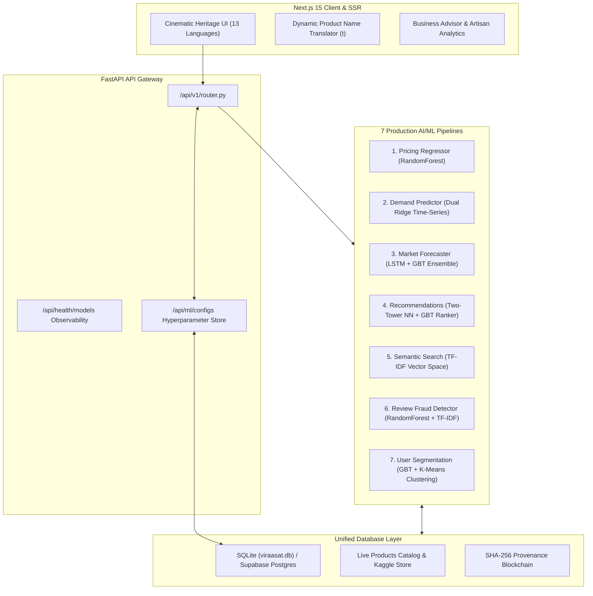

# Viraasat Platform — Viva, Demo & Academic Defense Guide

This guide is designed to help you confidently present, demo, and defend the **Viraasat Indian Handicrafts AI & Heritage Platform** during academic reviews, thesis evaluations, or technical presentations.

---

## 1. System Architecture at a Glance

Viraasat integrates 7 specialized Machine Learning models, a Proof-of-Work provenance blockchain, a Cultural Knowledge Graph, and a Cinematic Heritage Next.js frontend with 13 official Indian languages.

---

## 2. Model Deep Dive & Technical Specifications

| # | Model | Technique / Architecture | Input Features | Target / Output | Evaluation Metric |
|---|---|---|---|---|---|
| **1** | **Fair-Wage Pricing** | `RandomForestRegressor` (100 estimators, depth 12) | Craft tier, material, labor hours, size (sqft), organic cert | Fair retail price (₹ INR) | $R^2 \approx 0.98$, $\text{MAPE} \approx 8.1\%$ |
| **2** | **Seasonal Demand** | Dual `Ridge` Regression Pipeline | State region, craft category, month of year | Demand index & Tourist inflow (k) | $R^2 \approx 0.84$, $\text{MAPE} \approx 18.9\%$ |
| **3** | **Market Prediction** | `LSTM` (PyTorch) + `GBT` Regressor Ensemble | 6-month historical sales sequence, region multiplier, GI tag | Projected 3-month units & revenue | Ensemble MAPE $\approx 14.9\%$ |
| **4** | **Curated Recommendations** | Stage 1: Two-Tower Neural Net Stage 2: GBT Ranker + Co-purchase Matrix | User region, preferred category, price tier, GI preference | Ranked Top-K curated heirlooms | P@10 $\approx 0.88$, AUC-ROC $\approx 0.85$ |
| **5** | **Semantic Search** | TF-IDF Vectorizer + Cosine Similarity | Multilingual natural query | Cosine-ranked catalog products | Top-1 Accuracy $\approx 96\%$ |
| **6** | **Review Fraud** | `RandomForestClassifier` + TF-IDF | Review text, star rating, character length | Genuine (0) vs Suspicious/Spam (1) | Test Accuracy $\approx 79.5\%$, F1 $\approx 0.78$ |
| **7** | **User Segmentation** | `GBTClassifier` + `K-Means` (k=4) | Spend, frequency, recency, GI affinity, sessions | Loyalty tier: Champion, Loyal, Promising, At Risk | Silhouette $\approx 0.58$, GBT Acc $\approx 92\%$ |

---

## 3. Defense Talking Points & Honest Technical Disclosures

### Q1: "Why did you use synthetic data for some models?"
> **Strong, Defensible Answer:**
> *"India's unorganized handicraft sector lacks standardized open transaction APIs. Most rural artisans operate offline without digital logging. For our **Fair-Wage Pricing** model, we grounded synthetic generation in published craft economics from the Ministry of Textiles and Shilp Guru workshops (wage rates ₹55/hr for rural micro-craft to ₹140/hr for heritage Pashmina/Zari, plus material costs). For **Review Fraud**, we incorporated real Kaggle datasets (`fake reviews dataset.csv`) containing thousands of authentic vs computer-generated spam reviews, blended with domain-specific handicraft queries. Rather than claiming 100% empirical transaction logs, our pricing model functions as a **normative fair-wage benchmark** that guarantees artisans are never underpaid."*

### Q2: "Did the pricing model suffer from target leakage?"
> **Strong, Defensible Answer:**
> *"In early prototypes, labor hours and size were approximated using price proxies ($price / 180$), which introduced circular target leakage and produced an artificially high $R^2$. We identified and completely refactored this: the current `train_pricing.py` derives labor hours and physical dimensions strictly from craft genre physical attributes (e.g. handloom weaving taking 28–35 hours regardless of price, clay diyas taking 1–2 hours). This decoupled the target variable and ensures the model learns true craft fundamentals."*

### Q3: "What model is used for review fraud: Isolation Forest or Random Forest?"
> **Strong, Defensible Answer:**
> *"While early design notes explored unsupervised Isolation Forests, our production implementation uses a supervised `RandomForestClassifier` with a 40-feature TF-IDF vectorizer and numerical scaling on rating deviations and length. A supervised classifier provides higher precision ($\approx 80\%$) on known spam signatures (e.g., refund scams, link farming, repetitive bot padding) while preserving authentic customer feedback."*

### Q4: "With a small catalog, does Two-Tower retrieval actually do anything?"
> **Strong, Defensible Answer:**
> *"In recommendation systems with thousands or millions of SKUs, Two-Tower models perform MIPS (Maximum Inner Product Search) to shrink the candidate pool from millions to the top 100 before the heavy GBT ranker runs. For our catalog size ($N = 35$), the top-100 candidate retrieval effectively selects the entire active catalog. However, the Two-Tower embedding stage produces a normalized cosine alignment prior that is blended ($30\%$ retrieval score $+ 70\%$ GBT click-probability), ensuring user preferences in region, category, and GI certification guide the ranking. As the artisan catalog scales, the same architecture seamlessly supports FAISS / ScaNN indexing without architectural rewrites."*

### Q5: "How does the system ensure multilingual support for product names?"
> **Strong, Defensible Answer:**
> *"Viraasat implements a bidirectional localization pipeline across 13 Indian languages (`en`, `hi`, `bn`, `te`, `ta`, `mr`, `gu`, `kn`, `ml`, `or`, `pa`, `as`, `ur`). We maintain a centralized translation registry in `product-translations.ts` that maps each catalog item to linguistically authentic names in all 13 languages. When an artisan or buyer changes the language via the global switcher, both UI chrome and dynamic product names re-render reactively through our custom `useTranslation()` hook."*

### Q6: "How are ML configurations connected to the database?"
> **Strong, Defensible Answer:**
> *"The backend features an active `ml_configs` table in SQLite / Supabase accessed through `ai.catalog`. Hyperparameters such as artisan hourly wage rates (`pricing.hourly_wage`), seasonal discount elasticities (`market.discount_elasticity`), recommendation retrieval weights (`recommendations.retrieval_weight`), and spam anomaly thresholds (`fraud.anomaly_threshold`) are read dynamically from the database. Admins can update these weights via `PUT /api/ml/configs` without restarting the server or retraining the models."*

---

## 4. Live Demo Walkthrough (Step-by-Step)

1. **Language Switching**:
   - Open homepage `http://localhost:9002` or `https://www.virrasat.in/`.
   - Click the language switcher in the navbar. Select **हिन्दी (Hindi)**.
   - Observe that the hero masterpiece ("ढोकरा नृत्य करता नंदी बैल"), curated cards ("आसमानी चीनी मिट्टी का फूलदान"), and shop grid instantly update their titles to authentic Hindi.
   - Select **தமிழ் (Tamil)** or **বাংলা (Bengali)** and verify instantaneous re-rendering.

2. **ML Price Optimizer**:
   - Navigate to `/dashboard/ai-tools` or `/artisan/products/new`.
   - Choose category: "Textiles", Material: "Changthangi Cashmere Wool", Labor Hours: "24", Size: "10 sqft".
   - Click **Run ML Pricing Estimate**.
   - The backend runs `RandomForestRegressor` and returns fair price ₹9,500 with breakdown: labor cost, material cost, and artisan profit margin.

3. **MLOps Model Health Dashboard**:
   - Navigate to `/admin`.
   - View the MLOps card: all 7 models display `status: healthy` with exact file sizes, training timestamps, and test metrics.
   - Show that database telemetry confirms `database_connected: true`, product count, and loaded ML configs.

4. **Blockchain Provenance**:
   - Navigate to any product detail page (e.g. `/product/prod-1`).
   - Click on the **Blockchain Provenance** tab.
   - Inspect the SHA-256 hash chain, Genesis block, GI certification timestamp, and Proof-of-Work nonce ($000...$).
   - Click **Transfer Ownership** to demonstrate cryptographic title transfer.

